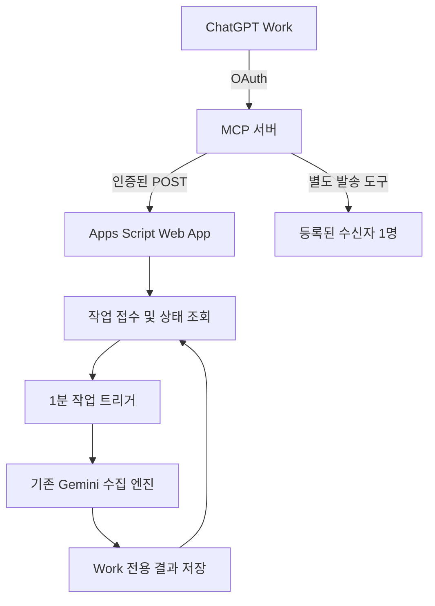

# ChatGPT Work 연동 설치 안내

## 제공 기능

| Work 도구 | 실행 내용 | 메일 발송 |
|---|---|---|
| `get_latest_briefing` | 저장된 Work 수집 결과 또는 정기 실행 스냅샷 조회 | 없음 |
| `start_briefing_collection` | 17개 카테고리 새 수집 접수 → 작업 ID 반환 | 없음 |
| `get_briefing_job` | 작업 상태·결과 조회 | 없음 |
| `send_briefing_email` | 완료된 Work 결과를 등록된 수신자 한 명에게 발송 | 명시적 요청 시만, 기본 비활성 |

기존 평일 정기 실행·메일 요청 트리거는 그대로 사용합니다. Work 수집은 기존 수집 엔진을 사용하지만, 별도 Drive 폴더에 결과를 저장합니다. **동향DB 중복 제거 이력 및 정기 실행 스냅샷은 변경하지 않습니다.** Work 개별 메일 역시 정기 발송 이력에 편입하지 않습니다.

새로운 OpenAI API 키는 필요 없습니다. 수집·인사이트에는 기존 Gemini API 키와 과금이 적용됩니다.

## 구성



**실행 장소:** Apps Script에서 수집하고, Node.js MCP 서버에서 Work와 통신합니다. 웹 기반 Work에는 접근 가능한 HTTPS MCP 서버와 OAuth 제공자가 필요합니다. 로컬 stdio 실행은 Codex CLI 등 로컬 MCP 클라이언트를 위한 방식이며 웹 Work에 자동 연결되지 않습니다.

## 1. Apps Script 갱신

1. 기존 스프레드시트의 Apps Script 프로젝트를 엽니다.
2. `07_Sheets.gs`를 이 버전으로 교체하고, `10_WorkApi.gs`를 추가합니다. 다른 `.gs` 파일은 이 브랜치의 기존 파일을 사용합니다. `mcp/`, `tests/`의 JS 파일은 Apps Script에 넣지 않습니다.
3. 프로젝트 설정 → 스크립트 속성에서 다음 값을 설정합니다.

| 속성 | 값 |
|---|---|
| `GEMINI_API_KEY` | 기존 키 유지 |
| `WORK_API_TOKEN` | 별도로 생성한 무작위 비밀값, 32자 이상 |
| `WORK_MAIL_ENABLED` | `false` (기본값) |
| `MONITORING_SPREADSHEET_ID` | 설치 함수가 자동 기록. 별도 프로젝트이면 직접 입력 |
| `WORK_RESULTS_FOLDER_ID` | 설치 함수가 전용 폴더를 만들고 자동 기록 |
| `WORK_API_ENABLED` | 설치 함수가 `true`로 설정 |

비밀값 생성 예시(본인 PC에서 실행; 대화창이나 GitHub에 붙여넣지 않기):

```sh
node -e "console.log(require('node:crypto').randomBytes(32).toString('hex'))"
```

4. **`setupWorkIntegration()`을 편집기에서 1회 실행**하고 Google 권한을 승인합니다. 반복 실행해도 작업 트리거가 중복 생성되지 않습니다. 이 단계에서는 메일을 보내지 않습니다.
5. 배포 → 새 배포 → 웹 앱: 실행 사용자 **나**, 접근 권한 **모든 사용자**로 배포합니다. 요청 본문의 비밀값을 검사하므로 무인 MCP 서버가 Google 로그인 없이 호출할 수 있습니다. 조직 정책상 익명 웹 앱 배포를 허용하지 않는 경우, 이 배포 방식은 사용할 수 없으며 Google OAuth를 지원하는 별도 실행 연결이 필요합니다.
6. `/exec`로 끝나는 배포 URL을 복사합니다. 기존 배포를 갱신할 때는 **새 버전으로 배포 업데이트**해야 코드 수정이 반영됩니다. `/dev` 테스트 URL은 사용하지 않습니다.

`setupTriggers()`는 기존 정기·이메일 트리거만 관리하며 Work 트리거를 제거하지 않습니다. Apps Script의 `atHour(9)`는 09시대 실행이며 09:00 정각 도착을 보장하지 않습니다.

## 2. 로컬에서 MCP 기능 검증

Node.js 22 이상을 사용합니다.

```sh
cd mcp
npm ci
# .env.example을 .env로 복사한 뒤 실제 URL/비밀값 입력
node --env-file=.env src/index.js
```

기본값은 `stdio`입니다. 위 실행은 터미널 메뉴가 아닌 MCP 프로토콜 서버이므로 입력 없이 대기하는 것이 정상입니다. 로컬 MCP 클라이언트에는 다음 형태로 등록합니다. 경로는 실제 절대경로로 바꿉니다.

```json
{
  "mcpServers": {
    "trade-monitor": {
      "command": "node",
      "args": [
        "--env-file=/absolute/path/newletterintegration/mcp/.env",
        "/absolute/path/newletterintegration/mcp/src/index.js"
      ]
    }
  }
}
```

등록 UI/설정 파일 구조는 사용하는 클라이언트에 맞춰 적용합니다. `.env`의 비밀값은 모델 입력이나 저장소에 포함하지 않습니다.

## 3. 웹 Work용 HTTPS 서버 배포

회사 서버 또는 선택한 호스팅 서비스에 `mcp/`를 배포합니다. Docker를 쓸 경우:

```sh
docker build -t trade-monitor-mcp ./mcp
docker run --env-file ./mcp/.env -p 8080:8080 trade-monitor-mcp
```

`.env`에서 `MCP_TRANSPORT=http`, 컨테이너 실행이면 `HOST=0.0.0.0`을 명시합니다. HTTPS는 호스팅 서비스나 리버스 프록시에서 종료합니다. 외부 주소의 경로는 `/mcp`여야 합니다.

| 환경변수 | 설정 |
|---|---|
| `GAS_WEB_APP_URL` | 앞에서 배포한 `/exec` URL |
| `GAS_API_TOKEN` | Apps Script의 `WORK_API_TOKEN`과 동일 |
| `MCP_TRANSPORT` | `http` |
| `MCP_PUBLIC_URL` | `https://서버주소/mcp` |
| `OAUTH_ISSUER` | OAuth 제공자의 정확한 issuer URL |
| `OAUTH_JWKS_URL` | 제공자의 공개 서명키(JWKS) URL |
| `OAUTH_ALLOWED_SUBJECTS` | 허용할 사용자 `sub`를 쉼표로 구분; 와일드카드 불가 |
| `ENABLE_SEND_TOOL` | 기본 `false` |
| `HOST`, `PORT` | 기본 `127.0.0.1`, `8080`; 컨테이너는 HOST 변경 |

### OAuth 제공자 설정

이 서버는 **기존 OAuth 제공자의 토큰을 검증하는 resource server**입니다. 사용자 로그인·authorization/token 엔드포인트를 직접 제공하지 않습니다. 다음 기능을 지원하도록 제공자를 구성해야 합니다.

- Authorization Code + PKCE S256, discovery metadata.
- ChatGPT의 CIMD/DCR 또는 미리 등록한 OAuth 클라이언트 방식 중 지원되는 연결 방식.
- 실제 Work 연결 화면에 표시되는 **정확한 callback URL** 허용.
- 요청된 `resource`를 토큰 `aud`로 반영. 이 구현의 audience는 `MCP_PUBLIC_URL`과 정확히 일치해야 합니다.
- RS256 또는 ES256 서명 JWT access token. `iss`, `aud`, `sub`, `exp`, `iat`, 공백으로 구분한 문자열 `scope` 클레임 필요. opaque token은 이 구현에서 지원하지 않습니다.
- `trade:read`(조회), `trade:collect`(새 수집), 선택적으로 `trade:send`(메일 발송) scope 발급. 모든 연결에는 `trade:read`가 필요합니다.
- 접속 가능한 subject를 `OAUTH_ALLOWED_SUBJECTS`에도 지정합니다. 여기 등록된 사용자들은 **같은 뉴스레터 데이터와 결과**를 봅니다. 사용자별 데이터 분리는 구현하지 않았습니다.

서버는 `/.well-known/oauth-protected-resource` 및 경로별 discovery URL을 제공하며, 인증 실패 시 OAuth challenge를 반환합니다. issuer가 자신의 discovery 문서를 제공해야 합니다. 제공자 설정을 마친 뒤 Work에서 원격 MCP 플러그인/연결을 추가하고 HTTPS `/mcp` 주소로 연결합니다. 메뉴 노출과 추가 권한은 계정·워크스페이스 정책에 따라 다릅니다.

**이 저장소를 GitHub에 올리는 것만으로 Apps Script 배포나 Work 연결이 활성화되지는 않습니다.** 배포 URL·비밀값·호스팅·OAuth 제공자 설정은 사용자의 실행 환경에서 완료해야 합니다.

## 4. 실제 사용 순서

- “저장된 마지막 정기 통상 브리핑을 보여줘.” → `get_latest_briefing(source="scheduled")`
- “지금 새로 수집해서 수출통제만 보여줘.” → `start_briefing_collection(requestId=새 UUID)` → 반환된 `jobId`를 `get_briefing_job(domain="export")`으로 조회
- “방금 수집한 결과에서 미국 반도체 규제의 원문과 영향을 설명해줘.” → 저장된 결과로 후속 분석

수집 요청은 빠르게 작업 ID를 반환합니다. 실제 작업은 1분 트리거가 가져가므로 시작 지연이 있을 수 있습니다. 응답의 `pollAfterSeconds`(30초)에 맞춰 조회합니다. 상태 조회 자체가 Gemini를 재호출하지 않습니다. 클라이언트가 대기를 중단해도 Apps Script 작업은 계속될 수 있으며, 같은 jobId로 나중에 확인합니다.

Work가 자율적으로 재조회하거나 사용자에게 완료 알림을 푸시하는 기능은 MCP만으로 보장하지 않습니다. 이 구현은 요청·조회 방식입니다.

### 선택: 메일 도구 활성화

1. Apps Script `WORK_MAIL_ENABLED=true`.
2. MCP 환경변수 `ENABLE_SEND_TOOL=true`로 변경하고 서버 재시작.
3. OAuth 사용자에게 `trade:send` 권한 부여 후 필요하면 재연결.
4. 사용자가 명시적으로 요청한 경우에만 `send_briefing_email` 호출. 완료된 **Work 수집 jobId**, 활성 명단의 이메일 **한 명**, 새 `requestId`, `confirm=true`가 필수입니다.

정기 스냅샷을 명단 전체에 재발송하는 기존 `resendLastBriefing()`은 MCP 도구에 노출하지 않았습니다. 새 수집·조회로 메일이 나가지 않습니다. 발송 시에는 기존 메일 조립 함수를 사용하므로 기본 수신 주소(To)에 실행 계정, 지정 수신자에 BCC로 보내는 기존 동작을 따릅니다.

## 5. 상태와 운영 규칙

| 상태/오류 | 의미 및 대응 |
|---|---|
| `queued` / `running` | 대기 / 실행 중. 30초 뒤 상태 조회 |
| `completed` | 수집 완료 또는 Gmail API의 발송 접수 성공. 받은편지함 배달을 보증하지 않음 |
| `partial` | 일부 카테고리 수집 실패. `failedUnits`를 사용자에게 표시 |
| `failed` | 실행 실패. 원인을 해결하고 새 requestId로 수집 가능 |
| `unknown` | 메일 실행 중 중단 또는 발송 결과 불명. 보낸편지함 확인 전 자동 재발송 금지 |
| `BUSY` | 다른 작업/정기 실행이 진행 중. 같은 requestId로 나중에 재시도 |
| `DAILY_LIMIT` | KST 기준 Work 수집 10회 또는 개별 발송 20회 한도 |
| `NOT_CONFIGURED` | 설치 트리거 또는 Gemini 키 누락 |
| `DEPLOYMENT_ACCESS` | Google 로그인 리다이렉트 등. 웹 앱 배포 권한 확인 |
| `UNAUTHORIZED` | Apps Script 비밀값 또는 활성화 상태 확인 |

- 같은 `requestId`는 같은 작업을 반환합니다. 통신 오류 후 재시도할 때 ID를 바꾸지 않습니다. 같은 ID를 다른 요청에 쓰면 `ID_CONFLICT`입니다.
- 결과·요청 이력은 7일 보관 후 **다음 접수 시** 정리합니다. 마지막 Work 결과와 실행 중 작업의 원본은 보존합니다. 보관기간이 지난 요청 ID는 중복 방지가 보장되지 않으므로 새 작업에는 항상 새 UUID를 씁니다.
- 작업 중 강제 종료되면 다음 작업 트리거가 중단 기록을 복구합니다. 실행 중으로 10분 이상 남아 있는 기록은 조회 응답에서도 실패/불명으로 표시합니다. 같은 ID로 메일을 자동 재시도하지 않습니다.
- 정기·이메일·Work 작업은 같은 ScriptLock을 사용합니다. 동시에 실행되면 지연되거나 기존 정기 실행의 잠금 대기 한도를 넘겨 건너뛸 수 있습니다. 정기 실행 시간대에 수동 수집을 몰아서 실행하지 않습니다.
- 비동기 접수는 MCP 연결 시간 초과를 줄여 줍니다. **Apps Script의 실행당 시간 제한과 Gemini 쿼터는 그대로 적용됩니다.**
- `source=scheduled`는 기존 스냅샷을 읽습니다. 원래 코드가 수신자 0명일 때도 스냅샷을 저장하므로 발송 완료로 단정하지 않고 `deliveryStatus=not_tracked`를 반환합니다.
- `domain`으로 결과를 필터링해도 통계는 전체 영역 기준이며 `statsScope=all_domains`로 표시합니다.
- API 중지: `WORK_API_ENABLED=false`. 작업 트리거가 남아 있어도 대기 작업은 발송/수집하지 않습니다.

## 6. 테스트

```sh
cd mcp
npm ci
npm test
```

Apps Script 서비스 모의 테스트와 MCP 실제 프로토콜 연결 테스트를 실행합니다. 인증 실패, 중복 실행, 메일 기본 비활성, 수신자 재검증, 중단 복구, 부분 수집 실패, JWT 검증, HTTP handshake를 확인합니다. 실제 Gemini 호출·Google 권한·메일 발송·Work OAuth 로그인은 배포 후 별도 확인이 필요합니다. 첫 운영 확인은 **메일 기능을 비활성화한 채 수집과 조회만** 실행합니다.

## 공식 참고 문서

- [OpenAI MCP 인증](https://developers.openai.com/plugins/build/auth)
- [Work/Codex MCP 연결](https://learn.chatgpt.com/docs/extend/mcp)
- [MCP TypeScript SDK v1](https://ts.sdk.modelcontextprotocol.io/server)
- [Apps Script 컨테이너 결합 스크립트와 Web App 제약](https://developers.google.com/apps-script/guides/bound)
- [Apps Script 웹 앱 배포](https://developers.google.com/apps-script/guides/web)
